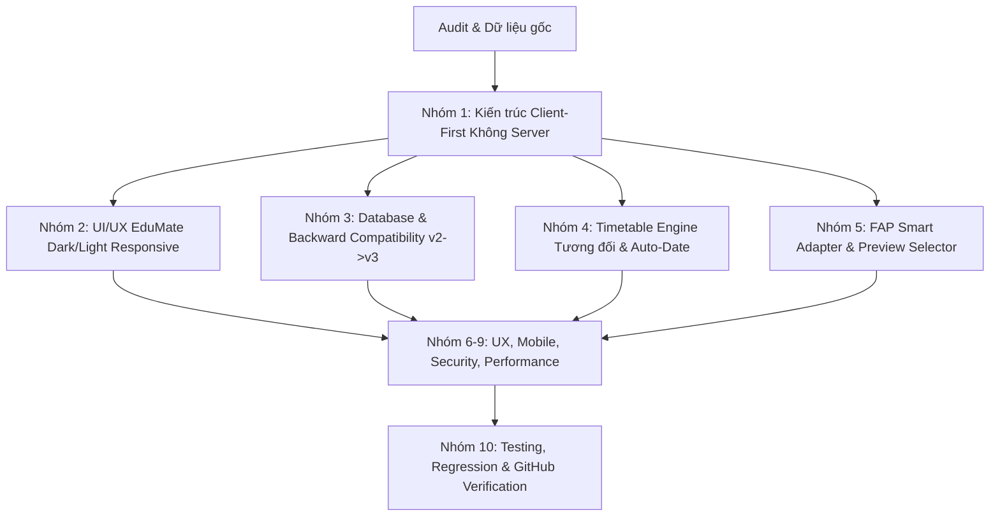

# UPGRADE PLAN — LEARNING MANAGEMENT SYSTEM 2.0
**Mô hình vận hành:** Multi-Agent Competition & Iterative Self-Improvement (10 Nhóm chuyên môn)  
**Ngày lập:** 09/11/2026

---

## 1. Kết quả đấu tranh & Lựa chọn giải pháp từ 10 Nhóm chuyên môn

### Chi tiết các phương án được phản biện & thống nhất:

1. **Nhóm 1 (Kiến trúc hệ thống):**
   - *Đề xuất cũ có thể gặp:* Viết lại bằng React/Next.js/Node.js nặng nề cần server backend.
   - *Phản biện:* Sinh viên cần sự gọn nhẹ, tức thì, có thể mở file trực tiếp hoặc host tĩnh miễn phí không cần server backend.
   - *Giải pháp chiến thắng:* **Modern Modular Pure ES6+ & Component-driven Architecture** trong một ứng dụng tĩnh tự chứa (Self-contained Web App). Giữ nguyên file `TKB (QLHT).html` được nâng cấp và tạo `index.html` chuẩn quốc tế, không phụ thuộc backend cồng kềnh.

2. **Nhóm 2 (Frontend & UI/UX):**
   - *Giải pháp chiến thắng:* Tái hiện xuất sắc phong cách giao diện **EduMate** từ ảnh người dùng:
     - Sidebar góc trái: Logo EduMate tím neon với icon sách + slogan, navigation item có bo tròn pill active.
     - Dark Slate Theme sang trọng (`#0f172a`, `#1e293b`) kết hợp Light Theme thanh lịch (`#f8fafc`, `#ffffff`).
     - Thẻ môn học bo góc mềm mại, phân biệt màu sắc pastel/vivid, hiển thị tên môn, mã, phòng và giờ học.
     - Nút tròn thêm nhanh nổi (FAB) góc dưới màn hình.

3. **Nhóm 3 (Backend & Database):**
   - *Giải pháp chiến thắng:* Giữ nguyên khóa `localStorage` `studyflow-tkb-v1`. Schema mở rộng an toàn sang v3:
     - Giữ nguyên mảng `subjects` và `rules` gốc.
     - Bổ sung tùy chọn lưu `tasks`, `exams`, `events`, `settings` (tên trường, chế độ xem, theme) vào cùng cấu trúc hoặc các khóa con an toàn.
     - Khi nâng cấp dữ liệu, hàm `upgrade(d)` tự động nhận biết schema cũ và bổ sung các trường mặc định mà không ghi đè bất kỳ bản ghi nào.

4. **Nhóm 4 (Quản lý thời khóa biểu & Tuần tương đối):**
   - *Giải pháp chiến thắng:*
     - Loại bỏ hoàn toàn chuỗi `START = '2026-11-02'` và `Về tuần 45` bị hardcode.
     - Tính toán `todayKey()` chuẩn theo múi giờ địa phương (`Asia/Ho_Chi_Minh`).
     - Thanh điều hướng: `[ ← TUẦN TRƯỚC ]` `[ HÔM NAY / TUẦN NÀY ]` `[ TUẦN SAU → ]`.
     - Nhãn tuần hiển thị: "TUẦN HIỆN TẠI (09/11/2026 – 15/11/2026)" hoặc "TUẦN TRƯỚC", "TUẦN SAU".
     - Chuyển ngày tự động theo thời gian thực (realtime ticker mỗi 60 giây).

5. **Nhóm 5 (Tích hợp FAP):**
   - *Giải pháp chiến thắng:*
     - Phương án an toàn, hợp pháp, không lưu thông tin đăng nhập: **Smart FAP Parser**.
     - Nhận diện cả HTML table được copy trực tiếp từ `fap.fpt.edu.vn/WeeklyTimetable` và văn bản thô (raw text).
     - Quy trình 4 bước trực quan: Mở FAP -> Copy -> Dán -> **Xem trước (Preview) & Chọn lọc** -> Nhập vào lịch.
     - Bảng Preview hiển thị chi tiết: Ngày, Thứ, Tiết, Môn, Phòng, Trạng thái (Mới / Trùng).

6. **Nhóm 6-9 (UX, Accessibility, Mobile, Security, Performance):**
   - Không giật lag khi chuyển tuần.
   - Thêm chế độ xem dạng Danh sách (Agenda View) cực kỳ tối ưu trên điện thoại.
   - XSS sanitization cho tất cả chuỗi nhập liệu.
   - Phím tắt (Keyboard shortcuts): `T` (về tuần này), `←` / `→` (chuyển tuần), `N` (thêm lịch mới).

7. **Nhóm 10 (Testing & Nghiệm thu):**
   - Tạo bộ kiểm thử tự động bằng Python để xác minh tính toàn vẹn của logic tính tuần, parser FAP và định dạng dữ liệu sao lưu.

---

## 2. Kế hoạch triển khai theo từng giai đoạn (Phase Roadmap)

- **Bước 1 (Đã hoàn thành):** Backup mã nguồn gốc `TKB (QLHT).original.bak.html` và hoàn thành 4 tài liệu Audit.
- **Bước 2:** Xây dựng Engine Quản lý Tuần & Ngày tương đối (loại bỏ hardcode tuần 45).
- **Bước 3:** Nâng cấp Bộ phân tích FAP (Smart Parser) kèm giao diện Preview & Kiểm tra trùng lịch.
- **Bước 4:** Xây dựng Universal Onboarding & Tùy biến trường học.
- **Bước 5:** Bổ sung các tính năng thông minh: Dashboard, Task & Deadline Manager, Exam Tracker, Focus Timer, Export .ics.
- **Bước 6:** Hoàn thiện giao diện UI/UX EduMate (Dark/Light mode, Responsive mobile/desktop).
- **Bước 7:** Kiểm thử tự động (Unit Tests, Data Integrity, Regression).
- **Bước 8:** Thiết lập Git repository sạch, commit và chuẩn bị đẩy lên GitHub.
- **Bước 9:** Lập Báo cáo nghiệm thu `docs/FINAL_UPGRADE_REPORT.md` và hoàn thiện `README.md`.
